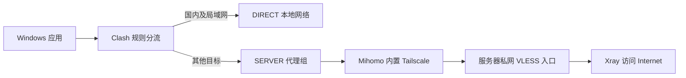

# Windows 智能分流教程：Clash Verge Rev + Tailscale

**国内直连，国外走自己的服务器；Windows 日常只开一个客户端。**

这份教程介绍一种组合方式：用 Clash Verge Rev 决定哪些流量直连、哪些走代理，用其 Mihomo 内核内置的 Tailscale 连接服务器，再由服务器上的 Xray 访问互联网。配套脚本用于安装服务、生成配置、检查连接和恢复设置。

> 适用范围：Windows 客户端 + 自有 Linux amd64 服务器。需要基本的服务器登录和命令行操作能力。这里不是现成的节点订阅或免费服务器服务。

## 它解决什么问题？

常见需求是：国内网站保持本地速度，访问 Google、GitHub 等服务时才使用服务器，同时尽量少开软件。

直接使用 Tailscale 全局出口很容易上手，但它与按域名/IP 规则分流是两回事。本教程让 Clash 负责分流，把 Tailscale 作为内部连接通道，而不是让全部流量交给独立 Tailscale 客户端。

| 需求 | 本教程的做法 |
|---|---|
| 国内直连、国外代理 | Clash 规则判断去向 |
| 电脑尽量只开一个软件 | 使用 Mihomo 内置 Tailscale |
| 服务器公网路径不稳定 | 尝试经 tailnet 私网连接；前提是当前网络可接入 Tailscale |
| Wi-Fi、热点切换，公网 IP 会变化 | 使用设备身份与私网连接，不绑定本机公网 IP |
| 希望代理更多软件而不只是浏览器 | 浏览器验证后再启用 TUN |

网络限制、中继可达性和服务器出口仍会影响效果。它不保证所有网络都可连接，也不保证一定比直连快。

## 一张图理解整体结构



**“单客户端”只指 Windows 端。** 服务器仍运行 Tailscale 和 Xray 两个服务。独立 Windows Tailscale 客户端可以用来初次准备或应急，但日常链路不要求它同时连接。

## 开始前准备什么？

- 可登录、可访问互联网的 **Linux amd64 服务器**，使用 systemd。
- 一个自己的 **Tailscale 账号**，分别授权服务器和电脑内置节点。
- Windows 安装 **Clash Verge Rev、Python 3.10+、PowerShell 7**。
- 支持 `type: tailscale`、inline provider 和 VLESS XUDP 的 **Mihomo 内核**。
- 当前网络可以完成 Tailscale 登录，并连接服务器 tailnet 地址。

从仓库页面 **Code → Download ZIP** 下载并解压；服务器和电脑各准备一份。下文相对路径命令都在项目根目录执行。

## 推荐阅读路线

| 当前情况 | 从这里开始 |
|---|---|
| 还不理解这些软件分别做什么 | [原理与术语](docs/concepts.md) |
| 想了解直连、中继、免费流量与速度 | [Tailscale 工作原理与带宽](docs/tailscale-network-and-cost.md) |
| 想从头搭建 | [完整安装教程](docs/deployment.md) |
| 节点空白、断网或必须开两个客户端 | [故障排查](docs/troubleshooting.md) |
| 关心费用、手机、DNS 或公网 IP 变化 | [常见问题](docs/faq.md) |

## 安装流程概览

### 1. 把服务器加入 Tailscale

按 [官方 Linux 安装说明](https://tailscale.com/download/linux) 安装并登录，确认服务器有 tailnet 地址且能解析域名。

### 2. 在服务器安装私网代理

在服务器项目根目录执行：

```bash
sudo bash server/install-private-proxy.sh
```

它安装 Xray，只在 **Tailscale 私网地址 `:10808`** 监听，不需要为这个入口开放公网端口，并生成客户端所需的 `server-info.json`。

### 3. 在 Windows 生成配置

将服务器参数文件保存到本机 `local/server-info.json`，在 **PowerShell 7** 执行：

```powershell
python -m pip install -r requirements.txt
$homeDir = Join-Path $env:APPDATA 'io.github.clash-verge-rev.clash-verge-rev'
python client/generate_profile.py `
  --server-info local/server-info.json `
  --state-dir "$homeDir/tailscale-split-state" `
  --out local/split.yaml
```

便携版或自定义数据目录请替换 `$homeDir`；它应对应实际 Mihomo 的 `-d` 主目录。

### 4. 导入 Clash，授权内置节点

Clash【订阅】导入 `local/split.yaml` 并启用，选择【规则】。首次代理请求触发内置 Tailscale 初始化，按日志中的设备链接授权。

【代理】应出现 **`SERVER → SERVER-NODE`**。

### 5. 先验证浏览器，再开启 TUN

先测试本地代理，确认独立 Tailscale 客户端断开时仍然工作。随后开启【系统代理】使用浏览器；需要覆盖更多应用，再开启【TUN / 虚拟网卡】。

**只打开 Clash 窗口不等于接管流量。** 系统代理和 TUN 都关闭时，浏览器通常仍用原网络。每步操作与成功判据见 [完整安装教程](docs/deployment.md)。

## 怎么判断真的成功？

- [ ] 独立 Tailscale 客户端已断开，Clash 仍然工作。
- [ ] Google、GitHub 和国内网站均可访问。
- [ ] 【连接】中，国内测试目标为 `DIRECT`，国外测试目标为 `SERVER`。
- [ ] 如需 UDP，SOCKS UDP 测试通过。
- [ ] 如需全机接管，已开启 TUN 并测试目标软件，而不只是浏览器。
- [ ] 重启电脑或切换网络后，连接可以恢复。
- [ ] 分别确认服务器与 Clash 内置节点的密钥到期设置，了解 [如何重新认证和恢复](docs/troubleshooting.md#密钥到期后如何续期)。

域名/IP 规则依赖 GeoSite、GeoIP 数据库。跨国服务和 CDN 可能需要自定义规则，单次分类结果不是永久保证。

## 需要撤回设置时

先关 Clash【系统代理】与【TUN】恢复普通网络；如准备了独立 Tailscale 出口，可重新连接。服务器与 Clash 恢复脚本见 [回退与恢复](docs/deployment.md#7-回退与恢复)。

## 配套脚本

| 目录 | 内容 |
|---|---|
| `server/` | 私网代理安装、可选 Tailscale 安装、可选全局出口、DNS 修复及回退 |
| `client/` | 配置生成、设置备份恢复、HTTP/UDP 测试 |
| `tests/` | 配置约束与文档链接检查 |

脚本不会代替读者完成账号授权。首次部署前请阅读完整教程，它们不是适配所有系统的一键安装器。

## 版本与官方资料

安装脚本固定 Xray `v26.10.21` 及其 SHA256；可选静态安装脚本固定 Tailscale `1.104.2` / Linux amd64。已有 Tailscale 可直接复用，升级时应重新校验配置和网络行为。

- [Mihomo 内置 Tailscale](https://wiki.metacubex.one/config/proxies/tailscale/)
- [Mihomo 代理集合](https://wiki.metacubex.one/config/proxy-providers/)
- [Clash Verge 本地导入](https://www.clashverge.dev/guide/profile.html)
- [Tailscale 出口节点](https://tailscale.com/docs/features/exit-nodes)
- [Xray VLESS](https://xtls.github.io/config/inbounds/vless.html)

本项目与上述软件无隶属关系。软件、组网服务、服务器和流量费用应分别考虑，以各服务当前规则为准。
